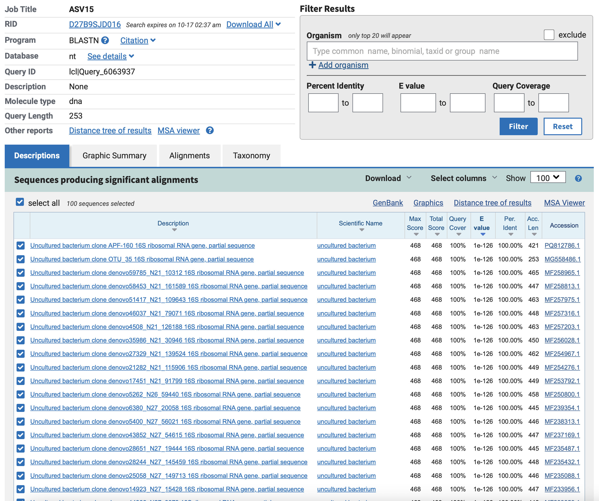
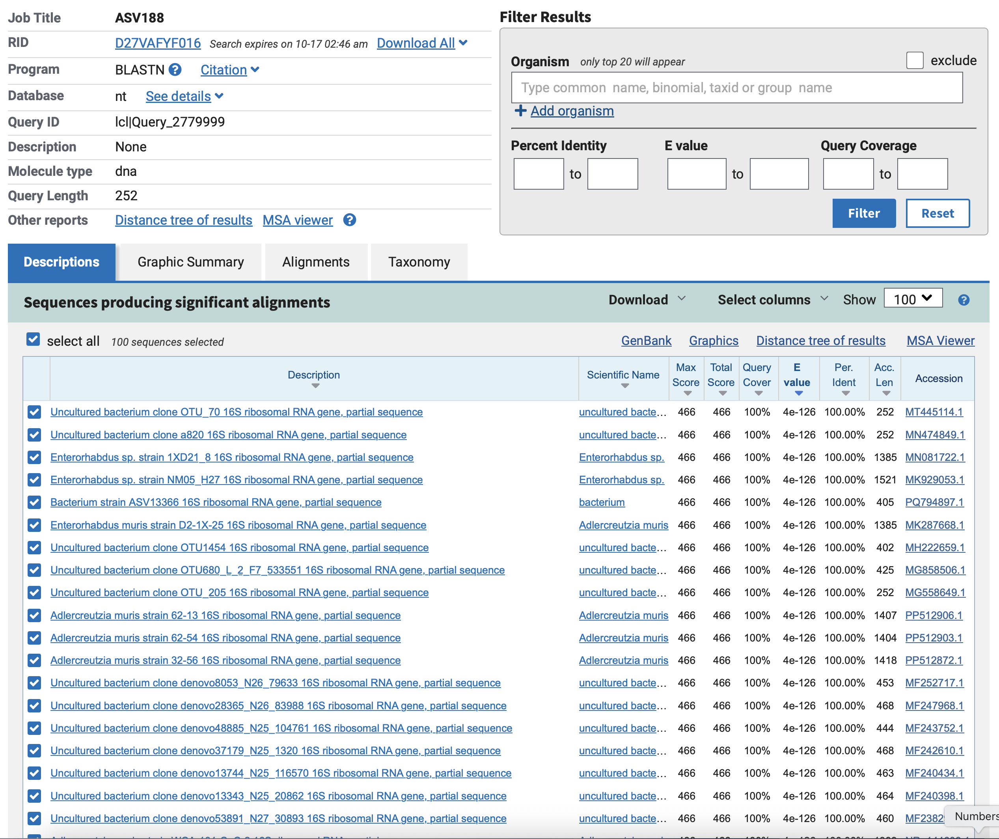

## Prep files

```{r}
#download the file
download.file(
  url = "https://mothur.s3.us-east-2.amazonaws.com/wiki/miseqsopdata.zip",
  destfile = here::here("data/miseqsopdata.zip"))

#unzip the to get individual fastq files

unzip("/Users/hmangat02/Desktop/lab5/Biol4315_lab5_repo_HM/data/miseqsopdata.zip")

#record path to data

data_dir <- here::here("data/MiSeq_SOP")
```

```{r}
# view metadata file 
read.delim(base::paste(data_dir,"mouse.dpw.metadata", sep = "/" ))[
  order(read.delim(base::paste(data_dir,"mouse.dpw.metadata", sep = "/" ))[[2]]),]
```

```{r}
#Taxonomy file
download.file(
  url = "https://zenodo.org/record/4587955/files/silva_nr99_v138.1_wSpecies_train_set.fa.gz?download=1",
  destfile = here::here(here::here("data/silva_nr99_v138.1_wSpecies_train_set.fa.gz")))
```

## Packages and Libraries Required

```{r}
#| echo: false
BiocManager::install("dada2")

```

```{r}

```

# File Prep

```{r}
# All forward and reverse fastq file names have the exact format: samplename_r1_001.fastq and samplename_r2_001.fastq
#Note the pattern

# Create file list for forward (R1) and reverse (R2)
fnFs <- sort(list.files(data_dir, pattern="_R1_001.fastq", full.names = TRUE))
fnRs <- sort(list.files(data_dir, pattern="_R2_001.fastq", full.names = TRUE))
```

# Quality Check

### Question 1

```{r}
# Visualize to examine forward reads 
plotQualityProfile(fnFs[1:4])
plotQualityProfile(fnFs[5:8])
plotQualityProfile(fnFs[9:12])
plotQualityProfile(fnFs[13:16])
plotQualityProfile(fnFs[17:20])
```

```{r}
# Visualize to examine reverse reads
plotQualityProfile(fnRs[1:4])
plotQualityProfile(fnRs[5:8])
plotQualityProfile(fnRs[9:12])
plotQualityProfile(fnRs[13:16])
plotQualityProfile(fnRs[17:20])
```

## Trim and Quality Filtering of Reads

```{r}
# Folder for filtered reads 
#R1
filtFs <- here::here("outputs/filtered", paste0(sample.names, "_F_filt.fastq.gz"))
names(filtFs) <- sample.names
#R2
filtRs <- here::here("outputs/filtered", paste0(sample.names, "_R_filt.fastq.gz"))
names(filtRs) <- sample.names
```

```{r}
# Filter samples using DADA2's default settings 
out <- filterAndTrim(fnFs, filtFs, fnRs, filtRs, truncLen=c(240,160),
                     maxN=0, maxEE=c(2,2), truncQ = 2 ,rm.phix=TRUE,
                     compress=TRUE, multithread = TRUE)
```

```{r}
# Check percentage of reads are left per sample 
out2 <- as.data.frame(out) %>% mutate(prop = (100*(reads.out/reads.in)))
head(out2)

# Sanity Check: 

# Mean % sequences left 
mean(out2$prop)

# min % of sequences 
min(out2$prop)

# sample with lowest number of reads 
min(out2$reads.out)
```

## Denoising and Unique Sequence Estimation

```{r}
# ML method to learn errors from data in filtered folder 
  # alternating error rate estimation and sample composition inference 
errF <- learnErrors(filtFs, multithread=T)
errR <- learnErrors(filtRs, multithread=T)
```

### Question 2

```{r}
# visualize learned errors for forward reads 
p1 <- plotErrors(errF, nominalQ=TRUE) + 
  labs(title = "Forward Read - Observed and Estimated Error Rate")

# visualize learned errors for reverse reads 
p2 <- plotErrors(errR, nominalQ=TRUE)  + 
  labs(title = "Reverse Read - Observed and Estimated Error Rate")

# export plots
output_dir <- "/Users/hmangat02/Desktop/lab5/Biol4315_lab5_repo_HM/outputs"
  # forward reads 
ggsave(filename = "forwardErrorRate.pdf",plot = p1, path = output_dir)

  # reverse reads
ggsave(filename = "reverseErrorRate.pdf",plot = p2, path = output_dir)
```

The reverse and forward reads appear to have similar trend lines.

## ASV Inference

```{r}
# dada function removes all seq. errors - outputs error corrected reads.  
dadaFs <- dada(filtFs, err=errF, multithread = TRUE)

dadaRs <- dada(filtRs, err=errF, multithread = TRUE)

# algorithm identifies actaul sequence variants by taking into account errors introducted during seq. or PCR.  
dadaFs[[1]]
```

## Paired-end read merging

```{r}
# Merge paired-end sequences - output each sample's merged seq. 
mergers <- mergePairs(dadaFs, filtFs, dadaRs, filtRs, verbose=TRUE)

# Inspect the merger data.frame from the first sample
DT::datatable(mergers$F3D0,options = list(scrollX = TRUE, autoWidth = TRUE))
```

## Sequence table construction

```{r}
# Tabulate data for analysis 
  # rows: samples 
  # columns: ASV's 
seqtab <- makeSequenceTable(mergers)

dim(seqtab)
```

```{r}
# Sanity check 
table(nchar(getSequences(seqtab)))
```

## Chimera removal

```{r}
# Removing chimeras: integration of 2 diff. templates to 1 PCR product
seqtab.nochim <- removeBimeraDenovo(seqtab, method="consensus", multithread=F, verbose=TRUE)

#Proportion ASVs were removed due to chimeras?
100-(dim(seqtab.nochim)[2]/dim(seqtab)[2]*100)
# 21% of a merged sequence variants represents chimeras 

sum(seqtab.nochim)/sum(seqtab)*100
# 96.4% of the total # of reads represents non-chimeric sequences.  
# So, only aprox 4% of total reads represents chimeric seq for merged sequences.  

```

```{r}
# Sanity Check
# read retention through pipeline 

# Function to sum # of unique occurances (seq)
getN <- function(x){ 
  sum(getUniques(x))
}

# Run defined function on all list elements to gather tracking data 
track <- cbind(out, sapply(dadaFs, getN), sapply(dadaRs, getN), sapply(mergers, getN), rowSums(seqtab.nochim))

colnames(track) <- c("input", "filtered", "denoisedF", "denoisedR", "merged", "nonchim")
rownames(track) <- sample.names

# Finally, calculate proportion kepy and display it
track <- as.data.frame(track) %>% mutate(prop_kept = round(nonchim/input*100,2))

DT::datatable(track)
```

```{r}
# Data polishing part 1 

# Update ASV matrix to data table (ie. workable format)
ASV_tbl <- as.data.frame(seqtab.nochim) %>% 
  `colnames<-`(base::paste("ASV", seq(1:ncol(seqtab.nochim)), sep = ""))

DT::datatable(ASV_tbl, options = list(scrollX = TRUE, autoWidth = TRUE))
```

```{r}
# Remove mock community 

ASV_tbl <- as.data.frame(t(ASV_tbl[-nrow(ASV_tbl),]))

# lets remove the ASVs that were only present in the mock communities

ASV_tbl <- ASV_tbl %>% mutate(rs = rowSums(ASV_tbl)) %>% 
  filter(rs > 0) %>% dplyr::select(-rs)
# lost 14 ASV's as mock community are human pathogens not expected in mice 


DT::datatable(ASV_tbl, options = list(scrollX = TRUE, autoWidth = TRUE))
```

```{r}
# Next, generate DNAStringSet variable - used to export FASTA file 

#Using DNAStringSet from Biostrings to read the seqs 
ASV_seqs <- DNAStringSet(base::colnames(seqtab.nochim) %>% 
                           `names<-`(base::paste("ASV",seq(1:ncol(seqtab.nochim)),sep = "")))
```

## Taxonomic assignment - Sequence annotation

```{r}
# Assign taxonomy to sequence variants 
taxa <- assignTaxonomy(seqtab.nochim, here::here("data/silva_nr99_v138.1_wSpecies_train_set.fa.gz"), multithread=TRUE)
```

```{r}
# Data polishing part 2

# update taxa matrix into datatable 
taxa2 <- as.data.frame(taxa) %>% 
  `row.names<-`(base::paste("ASV", seq(1:nrow(taxa)), sep = ""))

DT::datatable(taxa2,options = list(scrollX = TRUE, autoWidth = TRUE))
```

```{r}
# Based on inspection, some ASV were classified as cynobacteria/ chloroplast (unexpcted for mouse gut) or mitochondria 

# Remove non-prokaryotic ASV
taxa2 <- taxa2 %>% filter(Family != "Mitochondria") %>% filter(Order != "Chloroplast")

taxa3 <- taxa2 %>% mutate(ASVs = row.names(taxa2)) %>% dplyr::select(ASVs, everything())
ASV_tbl2 <- ASV_tbl %>% mutate(ASVs=row.names(ASV_tbl)) %>% dplyr::select(ASVs, everything())
```

```{r}
# Join taxa table - used for analysis outside of phyloseq 
taxa3 <- taxa3 %>% inner_join(ASV_tbl2, by = "ASVs")

# taxa2 used for phyloseq analysis 
taxa2 <- taxa2 %>% filter(rownames(taxa2)%in%taxa3$ASVs)

# filter original ASV table 
ASV_tbl <- ASV_tbl %>% filter(row.names(ASV_tbl) %in% taxa3$ASVs)

# Generate table of relative abundance of taxa per sample 
# sweep function used as samples are the columns 
taxa3[,(ncol(taxa2)+2):ncol(taxa3)] <- sweep(
  taxa3[,(ncol(taxa2)+2):ncol(taxa3)],2,
  colSums(taxa3[,(ncol(taxa2)+2):ncol(taxa3)]),'/')*100

# sanity check - Expect sum = 100%
colSums(taxa3[,(ncol(taxa2)+2):ncol(taxa3)])
```

### Question 3

```{r}
# Clean up StringSet
ASV_seqs[names(ASV_seqs)%in%ASV_tbl2$ASVs]

# Export StringSet to Fasta file 
writeXStringSet(ASV_seqs[names(ASV_seqs)%in%ASV_tbl2$ASVs], here::here("outputs/mouse_ASVs.fa"))

# Check the file is okay 
readLines(here::here("outputs/mouse_ASVs.fa"))[1:10]
```

```{r}
# ASV from phylum Firmicutes 
asv15 <- ASV_seqs[names(ASV_seqs) == "ASV15"]

as.character(asv15)

# BLASTn results against nr/nt database
  # 100 sequence results with no identified species name. 
```



```{r}
# ASV from phylum Actinobacteria
asv188 <- ASV_seqs[names(ASV_seqs) == "ASV188"]

as.character(asv188)

# BLASTn results against nr/nt database
  # All outputed sequences have 100% coverage 
  # species identified are Enterorhabdus sp., and Adlercreutzia muris
```



## Accuracy Evaluation

```{r}
# Evaluating DADA2’s accuracy on the mock community
unqs.mock <- seqtab.nochim["Mock",]
unqs.mock <- sort(unqs.mock[unqs.mock>0], decreasing=TRUE) # Drop ASVs absent in the Mock
cat("DADA2 inferred", length(unqs.mock), "sample sequences present in the Mock community.\n")

mock.ref <- getSequences(file.path(data_dir, "HMP_MOCK.v35.fasta"))
match.ref <- sum(sapply(names(unqs.mock), function(x) any(grepl(x, mock.ref))))
cat("Of those,", sum(match.ref), "were exact matches to the expected reference sequences.\n")
```

# Sample Analysis 

```{r}
# lets see what it looks like
mdta <- read.delim(base::paste(data_dir,"mouse.dpw.metadata", sep = "/" ))

# Are the sample names similar to the sample names we have in the ASV table?
length(mdta$group %in% colnames(ASV_tbl))

# No, so set the row names and massage the table

mdta <- mdta %>% mutate(category = if_else(dpw > 100 , "Late","Early")) %>% 
  mutate(gender = if_else(str_detect(group, "F"),"F","M")) %>%
  mutate(subject = str_extract(str_split_fixed(group, "D", 2)[,1],"(\\d)+")) %>%
  `row.names<-`(mdta$group)

#Generating the phyloseq object
ps <- phyloseq(otu_table(as.matrix(ASV_tbl), taxa_are_rows=T), 
               sample_data(mdta), 
               tax_table(as.matrix(taxa2)))

ps <- merge_phyloseq(ps, ASV_seqs)

ps
```

## Alpha diversity visualization

### Question 4

```{r}
#Lets calculate richness and diversity
#Shannon and Simpson are diversity estimators, ACE is a richness estimator, observed is how many ASVs we have (198)
rnd <- estimate_richness(
  ps, measures=c("Observed", "ACE","Shannon", "Simpson")) %>% 
  dplyr::select(-se.ACE)

DT::datatable(rnd[1:2])

# Export table as CSV file 

rnd.csv <- rnd[1:2]

write.csv(rnd.csv, file = here::here("outputs/richness_and_diversity.csv"), row.names = FALSE)
```
